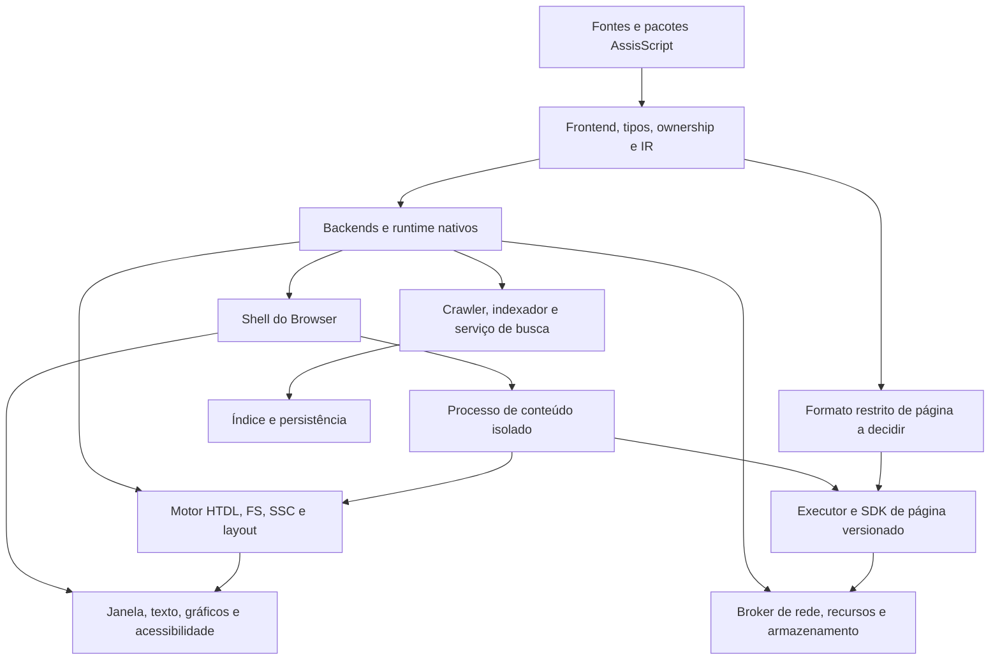

# Plano mestre — AssisScript como base do Browser, da busca e do ecossistema web

Versão da régua: **1**. Data: **29/10/2026**. Base nativa inspecionada: **3.3.0-alpha.15**, commit `e9183e7f98447e97feb2f2e7f1953c035e24f7e6`, com continuação local ainda não publicada. Este documento planeja evolução; não declara novas capacidades implementadas.

O objetivo é tornar o AssisScript capaz de implementar o navegador e seu motor, o buscador e seus serviços, além das ferramentas e APIs necessárias ao ecossistema HTDL, FluxStyle e SSC. A conclusão exige programas de referência funcionais escritos em AssisScript. Uma lista de recursos ou uma janela hospedada por outro aplicativo não basta para comprovar o objetivo.

Este é o plano da **capacidade da plataforma AssisScript**. Os produtos conservarão seus próprios backlogs de experiência, conteúdo, expansão e operação. Sua implementação mínima integrada entra aqui como prova de que a plataforma atende à finalidade. Não se promete indexar toda a internet nem compatibilidade universal com a web existente.

## 1. Como usar os documentos

- [Progresso calculado](PROGRESSO.md) e [fonte de estados, pesos e aceitação](PROGRESSO.json).
- [Baseline e hashes consultados](BASELINE-2026-10-29.json).
- [Masterprompt para próximas sessões](MASTERPROMPT.md), ao final deste plano como referência operacional.
- [Registro futuro destinado à pasta Browser](browser/IMPLEMENTACOES-FUTURAS.md), separado dos 60 critérios.
- [Relatório desta mudança](../relatorios/2026-10-29-planejamento-ecossistema.md).

Os **100/100 das fases 0–6** em `docs/PROGRESSO.json` encerram um escopo anterior. Permanecem históricos e independentes desta régua. Não somar as duas porcentagens nem substituir uma pela outra. A primeira baseline desta trilha é provisória e documental: reconhece fundações existentes sem reaplicar testes ou certificar os produtos.

## 2. Diagnóstico da base e do material disponível

O repositório real fica em `AssisScript/AssisScript`, dentro da pasta de trabalho externa. O remoto identificado é `https://github.com/Vibe-O-Coder/AssisScript.git`. A branch local inspecionada foi `development/native-arm64-icons-v1`. Há alterações de outras sessões no compilador, bibliotecas, testes, CI e documentação; elas são trabalho prévio e não devem ser misturadas automaticamente ao commit deste planejamento.

Há emissão nativa Windows x64, Linux x64/ARM64 e macOS x64/ARM64, IR tipada, ownership, generics, funções/closures, variantes, números, texto UTF-8, bibliotecas, pacotes offline, ferramentas e ABI C escalar. As evidências históricas registram execução nativa, instalação, depuração e CI de seus candidatos. O plano reaproveita essa base, respeitando os limites declarados.

As provas locais posteriores incluem incremento/decremento, microparser, contagem de palavras, coleções proprietárias mutáveis e testes Windows/Linux. Não equivalem a parser HTDL real, arena geracional, motor visual, runtime isolado ou buscador. Elas são citadas como material local, não como release ou teste reexecutado nesta sessão. O arquivo de baseline preserva hashes e separa arquivos rastreados de fontes ainda não publicadas.

`Hypertext Div Language` contém rascunhos 02, 03, 08, 12 e 14–19 sobre gramáticas, carregamento, execução, capacidades e conformidade. São insumos de arquitetura, não especificações finais ratificadas. As pastas Browser, WebAssis, FS e SSC estavam vazias na inspeção; nomes de pastas não comprovam implementação. Trechos históricos do HTDL descrevem versões antigas e não devem substituir o estado atual do AssisScript.

## 3. Arquitetura que a linguagem precisa viabilizar



O núcleo e a lógica dos produtos são escritos em AssisScript. Bibliotecas especializadas do sistema, codecs, TLS, fontes e runtimes podem ser acessados por adaptadores pequenos e auditáveis. Cada ponte documenta provedor, versão, licença, ABI, ownership, thread exigida e falhas. Uma prova de janela pode usar desenho por software; aceleração vem quando medidas justificarem.

Shell e broker são confiáveis. Conteúdo remoto não recebe acesso livre a arquivos, processos, FFI, segredos, rede ou janela. `safe` é uma garantia do subconjunto de memória, não uma política de autorização. Código nativo baixado não pode executar livremente como página. O ambiente de página deve ser especificado por contrato, independentemente da sintaxe autoral escolhida no futuro.

O runtime restrito poderá ser Wasm ou VM própria. A escolha precisa de decisão registrada e duas provas: semântica preservada e autoridade contida. Wasm exige backend/layout/runtime/imports e quotas reais; não resolve sozinho política de origem, custo de função hospedeira ou sandbox de processo. Processos e mensagens permitem paralelismo antes de introduzir threads e heap compartilhado.

## 4. O que precisa evoluir e onde

Cada tabela abaixo contém cinco critérios da régua. O campo de aceitação representa o **destino completo** do critério. O nível atual, sua justificativa e as fontes estão em `PROGRESSO.json`/`PROGRESSO.md`. Biblioteca, runtime, adaptador e aplicação contam como partes da plataforma; não se cria sintaxe nova quando uma biblioteca resolve o requisito com os contratos atuais.

### E00 — Contratos, arquitetura e rastreabilidade (4 pontos)

Camada principal: Especificação e governança. Dependências de contrato: nenhuma.

| ID | Entrega | Aceitação para encerrar o critério |
| --- | --- | --- |
| E00-01 | Especificações versionadas | Fixar gramáticas e catálogos HTDL/FS/SSC, versões, subconjuntos, diagnósticos e negociação; ligar cada requisito a cenários positivos e negativos executáveis. |
| E00-02 | Modelo de ameaças e privacidade | Inventariar ativos, agentes hostis e autoridades; testar origens, concessões, revogação, fluxo de dados, logs e comportamento de falhas por componente. |
| E00-03 | Fronteiras e decisões arquiteturais | Registrar decisões de backend de página, providers nativos, processos, protocolos e dependências; demonstrar separação shell/broker/conteúdo e atualização de versões. |
| E00-04 | Driver e matriz de conformidade | Executar corpus por perfil e sistema; distinguir pass/fail/not-run/unsupported, com hashes, versões e resultados sem depender de inspeção manual de exemplos. |
| E00-05 | Inventário, publicação e relatório | Vincular requisitos, commits, relatórios, evidências, dependências e suporte; publicar cada unidade de mudança no GitHub do AssisScript e verificar a revisão remota. |

### E01 — Linguagem, compilador e garantias semânticas (14 pontos)

Camada principal: Compilador e runtime. Dependências de contrato: E00.

| ID | Entrega | Aceitação para encerrar o critério |
| --- | --- | --- |
| E01-01 | DataLayout e ABI por destino | Explicitar tamanho/alinhamento de tipos, ponteiros, slices, vtables e retornos; testar C/IR/runtime em x64/ARM64 e no formato restrito escolhido, inclusive serialização entre larguras. |
| E01-02 | Tipos e abstrações para programas grandes | Preservar generics, classes/structs, enums exaustivos, Option/Result, funções/closures e efeitos; validar composição em parsers, grafos e serviços reais, com diagnósticos estáveis. |
| E01-03 | Ownership, vidas e destruição | Validar recursos compostos, mutação emprestada, callbacks com estado, cancelamento e encerramento de instância; impedir referência expirada, destruição dupla e reentrada inválida nas pontes. |
| E01-04 | Erros, números e contratos de falha | Definir erros recuperáveis, traps/panics de componente, overflow, NaN/Inf, conversões, limites e OOM; comprovar cleanup sem corromper perfil ou derrubar o shell. |
| E01-05 | IR, otimização e diagnósticos | Preservar avaliação/efeitos/cleanup e posições de fonte; comparar otimizado e referência, executar rejeições e equivalência em todos os alvos anunciados, incluindo novo perfil. |

### E02 — Memória, coleções, texto e dados grandes (8 pontos)

Camada principal: Runtime e bibliotecas. Dependências de contrato: E01.

| ID | Entrega | Aceitação para encerrar o critério |
| --- | --- | --- |
| E02-01 | Coleções proprietárias mutáveis | Oferecer arrays/vetores/mapas/filas com recursos Move, mutação, remoção e custos documentados; verificar empréstimos, drops e ordem dos filhos sob mutações aleatórias. |
| E02-02 | Arenas e identidades estáveis | Implementar NodeId e handles com categoria, instância e geração, IDs independentes de posição e relações ordenadas; rejeitar uso após remoção, reciclagem ou navegação. |
| E02-03 | Alocação e quotas recuperáveis | Disponibilizar alocação fallível/reserve, checagem de tamanho e quotas por instância; injetar OOM em cada fronteira e conservar estado válido sem abortar serviços vizinhos. |
| E02-04 | Unicode e edição de texto | Ampliar UTF-8 com normalização, case folding, segmentação de palavras/grafemas, bidi e quebra de linha via providers versionados; testar NUL, acentos combinantes e entradas inválidas. |
| E02-05 | Mapas e armazenamento eficientes | Definir hash resistente a colisões hostis, interning, buffers binários e vistas com invalidação explícita; medir arenas, segmentos e coleções sob crescimento/remoção. |

### E03 — Sistema, tarefas, processos e integração de eventos (10 pontos)

Camada principal: Runtime, bibliotecas e adaptadores. Dependências de contrato: E01.

| ID | Entrega | Aceitação para encerrar o critério |
| --- | --- | --- |
| E03-01 | Arquivos, caminhos e diretórios | Oferecer enumeração/metadados, caminhos Unicode, operações relativas a raiz e permissões; testar links, traversal, TOCTOU e cancelamento sem expor pastas à página. |
| E03-02 | Loop responsivo e I/O não bloqueante | Integrar eventos nativos, polling de I/O, timers monotônicos, deadlines e filas limitadas; assegurar fairness, pressão de retorno e cancelamento com callbacks em thread correta. |
| E03-03 | Workers, IPC e supervisão | Evoluir processos/pipes para protocolo binário versionado, framing, tamanho máximo, transferências e encerramento; recuperar worker travado/derrubado sem deadlock ou mensagem tardia. |
| E03-04 | Ciclo de vida de recursos e assinaturas | Cancelar árvore de tarefas, revogar subscriptions, fechar handles e drenar trabalho ao fechar aba/perfil; definir reentrada e impedimento de callback após drop. |
| E03-05 | Paralelismo com contrato seguro | Adotar primeiro processos e mensagens; demonstrar CPU/I/O em segundo plano. Se threads forem necessárias, especificar envio/compartilhamento, atomics, modelo de memória e análise de corridas antes de expor heap compartilhado. |

### E04 — Plataforma gráfica, entrada e acessibilidade (10 pontos)

Camada principal: Bibliotecas e adaptadores nativos. Dependências de contrato: E01, E03.

| ID | Entrega | Aceitação para encerrar o critério |
| --- | --- | --- |
| E04-01 | Ponte nativa segura e versionada | Encapsular ABI C, handles, buffers e erros com ownership; usar shim para agregados/varargs ou thread estrangeira, ou ampliar FFI com testes independentes de ABI nos cinco destinos. |
| E04-02 | Janela, monitores e eventos | Abrir/redimensionar/fechar janela, integrar DPI, múltiplos monitores, foco, teclado/ponteiro/touch e suspensão; testar loop nativo sem espera ocupada e liberação de recursos. |
| E04-03 | Desenho, imagens e composição | Implementar superfícies, clipping, transforms e snapshots imutáveis com fallback de renderização; decodificar imagens sob limites e isolamento, testar perda/recriação de recursos e hit testing consistente. |
| E04-04 | Fontes, edição e entrada de texto | Integrar shaping/fallback/bidi, medição e quebra, seleção, clipboard e IME; validar edição com graphemes, escala 200%, RTL e navegação por teclado em providers de cada OS. |
| E04-05 | Acessibilidade e políticas do usuário | Exportar árvore semântica, nome/role/valor, foco e ações às APIs assistivas do OS; testar leitor de tela, contraste, zoom e movimento reduzido com usuário e automação. |

### E05 — Rede, URLs e serviços web (8 pontos)

Camada principal: Bibliotecas e broker. Dependências de contrato: E01, E03.

| ID | Entrega | Aceitação para encerrar o critério |
| --- | --- | --- |
| E05-01 | Cliente HTTP(S) geral | Adicionar métodos, status, cabeçalhos, corpos/upload, autenticação explicitamente concedida e TLS verificado; provar cancelamento e reutilização sem bloquear UI ou vazar estado entre origens. |
| E05-02 | Políticas de navegação e origem | Aplicar redirects limitados, cookies, cache/validadores, partição, proxy explícito e proteção de conteúdo misto; revalidar destino e autoridade em cada salto e após resolução DNS. |
| E05-03 | URL, DNS e codificação | Criar parser/serializer de URLs com relativos, percent encoding, IPv6, IDNA e origem opaca local; separar canonicalização para busca de autorização; testar corpus externo e DNS hostil. |
| E05-04 | Streaming e canais contínuos | Oferecer leitura incremental, buffers limitados, backpressure, compressão com teto de expansão, downloads retomáveis e canais de atualização previstos no contrato; avaliar WebSocket por requisito. |
| E05-05 | Servidor e serviço de consulta | Disponibilizar escuta/aceitação e HTTP por provider ou serviço integrado, com concorrência, limites e encerramento; testar solicitações truncadas/lentas, framing, timeouts e autenticação administrativa. |

### E06 — Executor restrito, capacidades e isolamento (10 pontos)

Camada principal: Backend, runtime e host. Dependências de contrato: E00, E01, E03.

| ID | Entrega | Aceitação para encerrar o critério |
| --- | --- | --- |
| E06-01 | Formato de execução de página | Escolher VM/Wasm com ADR e prova; implementar layout, validação, loader e imports permitidos; preservar semântica declarada e comparar execução com referência nativa ou oráculo. |
| E06-02 | Memória, CPU e interrupção | Limitar heap, pilha, instruções/tempo, compilação, mensagens e chamadas hospedeiras; interromper loop, recursão e host bloqueante sem prejudicar shell ou outra aba. |
| E06-03 | Capacidades e API hospedeira | Negar arquivos/processos/FFI/rede/relógio por padrão; expor somente imports versionados e tokens revogáveis por origem/instância/geração; testar forja, replay e confused deputy. |
| E06-04 | Sandbox de processo por OS | Implementar restrições nativas de conteúdo/broker em Windows/Linux/macOS, herança mínima e filtros apropriados; testar tentativa real de acesso a rede, perfil, arquivos e processos sem concessão. |
| E06-05 | Ciclo de vida e recuperação de aba | Inicializar/eventuar/descartar instância, invalidar callbacks e interromper conteúdo travado; validar reload, navegação, falha e rollback de ativação com isolamento entre abas. |

### E07 — HTDL, árvore semântica e SDK de documentos (8 pontos)

Camada principal: Bibliotecas e integração de referência. Dependências de contrato: E00, E02, E04.

| ID | Entrega | Aceitação para encerrar o critério |
| --- | --- | --- |
| E07-01 | Parser e diagnóstico HTDL real | Implementar gramática versionada com atributos, comentários, entidades, semântica, spans e recuperação; executar corpus real, limites e entradas hostis sem recursão não limitada. |
| E07-02 | Árvore, seletores e mutações | Oferecer criação/remoção/consulta, hierarquia ordenada, atributos/tipos semânticos e invalidação; manter identidade geracional, foco e acessibilidade coerentes após transações. |
| E07-03 | SDK e ABI htdl_v1 | Definir handles, tipos, erros, strings e assinaturas de inicialização/eventos; oferecer pacote compilável com APIs canônicas em inglês e compatibilidade/versionamento sem acesso a ponteiros do host. |
| E07-04 | Estado, eventos e transações | Implementar células por página/nó, inscrição/desinscrição, snapshot e fila determinística; cobrir teclado/ponteiro, disabled/hidden, remoção e falhas sem handlers tardios. |
| E07-05 | Loader e ativação atômica | Carregar HTDL, código, FS/SSC e recursos locais/remotos sob política; resolver versões/dependências, validar antes de ativar e descartar resultados atrasados; cache somente de artefato imutável. |

### E08 — FluxStyle, SSC, layout e integração visual (8 pontos)

Camada principal: Bibliotecas e motores de referência. Dependências de contrato: E00, E02, E04.

| ID | Entrega | Aceitação para encerrar o critério |
| --- | --- | --- |
| E08-01 | Frontend e avaliador FluxStyle | Implementar gramática/tipos/unidades, seletores/bindings, DAG, produtor único e avaliação incremental pura; testar ciclos, ramos curtos, conflitos e dirtiness sem cascata implícita. |
| E08-02 | Layout e snapshots coerentes | Definir constraints, distribuição row/column, texto, overflow/scroll e invalidações; provar ausência de ciclo geométrico e uso do mesmo snapshot por desenho, hit test e acessibilidade. |
| E08-03 | Perfil numérico e temporal SSC | Fixar representação/faixa, arredondamento, coeficientes e passo de tempo; implementar parser/canais com vetores independentes e fallback de erro numérico, sem prometer igualdade de float sem prova. |
| E08-04 | Foco, movimento e falhas reativas | Integrar transações semânticas e visuais, conservar último estilo válido com disabled atual, congelar movimento em edição, pausar aba oculta e respeitar reducedMotion sem backlog físico. |
| E08-05 | Corpus visual e inspeção | Executar contador, leitura e dois painéis com screenshots controladas, árvores/eventos e leitor de tela; inspecionar grafo, custos e versões com diagnóstico de origem. |

### E09 — Persistência, perfil e formatos de armazenamento (8 pontos)

Camada principal: Bibliotecas e serviços. Dependências de contrato: E02, E03.

| ID | Entrega | Aceitação para encerrar o critério |
| --- | --- | --- |
| E09-01 | Commit durável e recuperação | Implementar WAL/transação ou provider testado, flush de arquivo/diretório, commit e recuperação; injetar interrupções, disco cheio e corrupção, definindo diferença entre kill e perda de energia. |
| E09-02 | Serialização e formatos versionados | Oferecer leitores/escritores binários e texto incrementais, checksums, endianness, limites e migrações; testar entrada truncada, versão desconhecida e snapshot independente do layout de memória. |
| E09-03 | Banco, segmentos e consultas | Integrar provider de banco ou implementar segmentos/índices transacionais com iteração, compactação e leitura concorrente; demonstrar conjunto maior que RAM sob limites definidos. |
| E09-04 | Perfil, partições e dados sensíveis | Separar configurações, histórico, favoritos, cookies e cache por perfil/origem; proteger credenciais por provider do OS, testar limpeza completa e modo privado sem persistência incidental. |
| E09-05 | Quotas, migração e concorrência | Definir locks, ownership de arquivo, tamanho máximo, backup/restore e migração reversível; testar dois processos, crash durante upgrade e revogação de armazenamento de origem. |

### E10 — Rastreamento, indexação e consulta do buscador (6 pontos)

Camada principal: Bibliotecas e aplicação de referência. Dependências de contrato: E02, E05, E09.

| ID | Entrega | Aceitação para encerrar o critério |
| --- | --- | --- |
| E10-01 | Extração e análise linguística | Extrair texto/links de vários documentos, preservar docId e posições, normalizar e tokenizar por política; comparar termos e offsets a um oráculo multilingue. |
| E10-02 | Crawler e fronteira persistente | Oferecer fila por host, robots.txt, deduplicação, canonicalização, sitemap opcional, politeness, retries/backoff e reindexação; negar redes privadas/loopback por política após DNS/redirect. |
| E10-03 | Índice invertido em disco | Implementar postings por doc/posição, segmentos, compressão, merge, update/delete e tombstones; recuperar crash e conferir consultas após reinício contra modelo independente. |
| E10-04 | Consulta, ranking e avaliação | Definir sintaxe de consulta, interseção/união/frases, ranking inicial explicável, paginação, snippets seguros e cache; medir precisão/recall ou NDCG em corpus rotulado e comparar consultas exatas ao oráculo. |
| E10-05 | Serviço de busca e operação | Servir consultas pelo transporte escolhido, integrar submissão voluntária no Browser e demonstrar atualização concorrente do índice, limites, logs sem consultas privadas, recuperação e abuso controlado. |

### E11 — Ferramentas, distribuição e aceite integrado (6 pontos)

Camada principal: Ferramentas e qualidade de entrega. Dependências de contrato: E00, E01.

| ID | Entrega | Aceitação para encerrar o critério |
| --- | --- | --- |
| E11-01 | Builds, pacotes e dependências | Garantir build limpo reprodutível, manifestos/lockfiles, providers e hashes coerentes; distribuir SDK/runtime/stdlib/editor com instalação, atualização e remoção testadas por perfil. |
| E11-02 | Editor, debugger e ferramentas web | Ampliar LSP/fmt/check/test/doc com DSLs, source maps e depuração de página/host; mostrar erro de import/quota/handle com span e origem; integrar inspector local sem dar autoridade à página. |
| E11-03 | CI, fuzzing e validação multiplataforma | Executar suites semânticas e ABI por destino nativo, corpus/fuzzing diferencial e falhas injetadas; bloquear promoção por testes omitidos, incompatibilidade de provider ou erro de sandbox. |
| E11-04 | Performance, carga e orçamento | Fixar corpus/hardware/seeds e medir p50/p95/p99, memória, handles e bytes; ensaiar UI, crawler e busca em conjunto por 24h reais e comparar candidato à baseline sem regressão não justificada. |
| E11-05 | Compatibilidade, atualização e aceite | Publicar política por perfil, inventário/procedência e atualização verificada com rollback; terceiro instala e usa demos Browser/busca pelo manual em revisão exata, com canais de correção e vulnerabilidade. |

## 5. Contratos transversais obrigatórios

### 5.1 Semântica e APIs da linguagem

Conservar APIs e palavras canônicas em inglês, com documentação em português. Não restaurar aliases antigos, comentários por palavras ou exemplos de sintaxe removida. Antes de acrescentar traits/interfaces, async/await, novas capturas, varargs, unions C ou outro mecanismo, demonstrar o caso que os recursos atuais não atendem e registrar a alternativa por biblioteca/adaptador. Encapsulamento, pureza, ordem de avaliação, overflow, cleanup e estabilidade de tipos precisam permanecer verificáveis.

Há lacunas de ergonomia que podem exigir expansão, por exemplo callbacks com estado e empréstimo exclusivo, contêineres Move e composição de erros. A necessidade é o caso de uso seguro, não uma lista obrigatória de palavras-chave. Macros, self-hosting, JIT próprio, GC novo e compilador reescrito na própria linguagem não são pré-requisitos por si só. Se alguma decisão futura os tornar necessários, justificar e versionar o escopo antes de pontuar.

### 5.2 API hospedeira e protocolo de mensagens

Toda chamada entre módulos/processos define: versão, operação, tamanho, requestId, instância, origem atribuída pelo host, geração de recurso e resultado tipado. Mensagens não carregam ponteiros do processo emissor. Comprimentos são conferidos antes de alocar ou copiar; valores desconhecidos e mensagens truncadas são recusados. Strings usam comprimento e encoding declarados. Framing, limites, cancelamento, duplicação, reentrada e descarte de resposta tardia têm testes.

Handles são opacos, não índices reutilizáveis sem geração. IDs de nós, instância de documento, transação, quadro, pedido e canal temporal são domínios distintos. Remove/reload invalida os tokens anteriores. Cache de AST/código não compartilha estado, handles, campos de formulário ou células reativas entre instâncias.

### 5.3 Rede, armazenamento e privacidade

Definir o perfil HTTP inicial e as limitações de protocolo; usar TLS validado por provider mantido em vez de inventar criptografia. URL de recurso, origem e URL canônica de indexação não são a mesma identidade. O broker decide esquemas, redirects, DNS, proxy, envio de credenciais e acesso local em cada etapa. Crawler nega destinos privados por padrão no perfil público, com exceção explícita para testes locais. Cookies e cache são particionados e removíveis; documentos locais recebem concessão e origem opaca adequadas.

Credenciais ficam no serviço do sistema quando necessário; usar gerador criptográfico do OS para segredos, nunca o PRNG comum. Relatórios, traces e logs não persistem senhas, texto de campos ou consultas privadas por padrão. Telemetria, sincronização e sugestão de busca por digitação exigem decisões próprias e não são dependências do núcleo. Um serviço remoto não recebe automaticamente documentos locais para tradução ou indexação.

### 5.4 Recuperação e responsividade

Loop cooperativo sozinho não interrompe página hostil. Quotas incluem compilação, instruções, memória/pilha, mensagens, arquivos/descritores, imagens descomprimidas, nós, profundidade, canais e chamadas ao host. I/O lento ou decoder ruim não bloqueia o shell. Ao fechar uma aba, cancelar descendentes, revogar permissões, ignorar respostas atrasadas e destruir recursos exatamente uma vez.

OOM, disco cheio, worker morto, arquivo corrompido, certificado inválido e provider ausente têm resultado de componente definido. Falha de FS preserva as saídas autorais válidas previstas no contrato sem reverter o estado semântico atual. Falha em um canal SSC não autoriza números fora de faixa nem troca silenciosa de perfil numérico.

### 5.5 Compatibilidade com a web existente e extensão do produto

A linha principal usa HTDL/FS/SSC. O primeiro importador HTML é de leitura estática com perdas explícitas, preservando origem e sem executar JavaScript. A linguagem precisa viabilizar parsing de HTML, árvore e adaptação para representação semântica; mapear tags não demonstra compatibilidade geral. CSS importado terá adaptador e política próprios quando suportado. Navegação em sites com JS completo, mídia/DRM, impressão avançada, WebRTC/WebGPU, extensões arbitrárias e sincronização são expansões de produto, com novos critérios se forem incorporadas à promessa pública.

WebSocket, HTTP/2/3, codecs adicionais e aceleração podem ser fornecidos por providers; o núcleo anuncia exatamente o subconjunto testado. O fechamento desta régua não pode ser usado para anunciar recursos fora desse perfil. O suporte normativo a entrada, texto, acessibilidade, origens e recuperação não fica opcional por ser menos visível que o desenho.

## 6. Sequência de execução e marcos demonstráveis

As dependências E00–E11 orientam contratos, não exigem terminar uma frente inteira antes de prototipar outra. Os marcos abaixo cortam as frentes verticalmente. Sessões podem trabalhar em tarefas independentes, respeitando arquivos e decisões compartilhadas; nenhuma delegação automática é exigida pelo plano.

| Marco | Incremento concreto | Dependências e saída de aceite |
| --- | --- | --- |
| M0 — Baseline reproduzível | Reconciliar HEAD, trabalho local e remoto; escolher perfis, providers e corpus; publicar especificações de interfaces | E00, E01, E11: fontes identificadas, builds de referência, ADRs e resultados reais; arquivos locais anteriores entram em mudança separada validada |
| M1 — Estruturas e fronteira nativa | Arena geracional, mutação Move, alocação fallível e shim mínimo de plataforma | E01–E04: oráculo de mutações/IDs, drops e testes C independentes, erros de provider e OOM |
| M2 — Primeira janela útil | Programa AssisScript abre janela, desenha texto acentuado, recebe teclado/ponteiro, redimensiona e fecha | E03/E04: loop responsivo, recursos contados e demonstração nativa nos sistemas anunciados |
| M3 — Visualizador HTDL local | Parser real, árvore/semântica, texto, controles, seleção, scroll e acessibilidade | E02/E04/E07: corpus do subconjunto declarado, controle sem script e importação HTML estática inicial; satisfaz G1 apenas com o perfil completo escolhido |
| M4 — Programa de página isolado | Backend/VM restrito, host versionado, contador por clique e teclado, cancelamento e reload | E01/E03/E06/E07: loop hostil interrompido, memória limitada, imports negados, token expirado e aba vizinha intacta |
| M5 — Apresentação reativa | FS tipado, layout incremental e SSC com perfil numérico e snapshots | E07/E08: leitura e dois painéis, cenários de ciclo/falha/foco/hidden, movimento reduzido e corpus numérico; gate G3 |
| M6 — Navegação remota | Rede geral, loader, partição, cookies/cache necessários, downloads e shell com abas/voltar/recarregar | E05/E06/E07/E09: servidor local controlado, redirects/DNS hostis, navegação durante I/O, falha de conteúdo e política observada; gate G2 |
| M7 — Busca local persistente | Corpus em disco, índice invertido, atualização/exclusão e consulta com ranking inicial | E02/E09/E10: resultado contra oráculo após restart, crash e compactação, corpus maior que RAM; primeira fatia pode anteceder M6 |
| M8 — Crawler e serviço integrados | Fronteira persistente, robots, limites por host, serviço HTTP e consulta pelo Browser | E05/E09/E10: sem submissão automática de digitação, sem alcançar destino proibido, reindexação/consulta simultâneas e métricas; gate G4 |
| M9 — Candidato de distribuição | SDK/editor/runtime/providers/instaladores coerentes e documentação de todas as limitações | E00–E11: CI nativa por perfil, soak real de 24h da carga integrada, pacote verificável e aceite por terceiro na revisão exata; gate G5 |

M0 precisa gerar uma ordem de tarefas com tamanho de uma sessão e estimativas após as primeiras medições. Não há prazo ou número de sessões confiável antes da prova de plataforma e da escolha de runtime. Toda tarefa registra ID, entrada, saída, dependências, teste de aceite, riscos, resultado e próxima tarefa. A prioridade é remover o bloqueio demonstrado do próximo marco, sem adicionar recursos especulativos.

### Primeira fila recomendada

1. Publicar ou reconciliar, em entregas próprias, as continuações locais de incremento/microparser e OwnedArray, conferindo testes e diferença em relação aos pacotes. Não sobrescrever trabalho de outra sessão nem presumir que a documentação local já esteja no GitHub.
2. Congelar o perfil mínimo de visualizador e a ABI do shim de plataforma; registrar a estratégia do runtime de página. Trazer os rascunhos normativos necessários para uma referência versionada publicamente acessível.
3. Implementar arena com geração e teste independente de operações/reciclagem; definir alocação fallível e limites do documento.
4. Entregar janela nativa com texto, eventos e loop; em seguida testar o subconjunto HTDL real com a mesma estrutura de dados.
5. Avançar simultaneamente apenas em contratos independentes de rede/persistência. O primeiro índice multidocumento pode ser validado por CLI antes da interface final.

## 7. Régua de conclusão

São 12 frentes, **60 critérios**, **100 pontos**. Os pesos somam 100 e os cinco critérios de uma frente dividem seu peso igualmente. Para cada critério, nível `s` de 0 a 4:

| Nível | Crédito | Exigência |
| --- | ---: | --- |
| 0 | 0% | Ausente, somente intenção ou sem demonstração aproveitável |
| 1 | 25% | Fundação relevante/protótipo parcial ou especificação inicial verificável; limitações explícitas |
| 2 | 50% | Implementação útil e reproduzível de subconjunto relevante, com casos positivos e negativos |
| 3 | 75% | Contrato funcional atendido e testes adversos/falhas e alvos aplicáveis demonstrados; integração/aceite final ainda aberto |
| 4 | 100% | Aceitação integral da linha, integração de referência reproduzível, documentação, evidência de destinos e publicação exata verificadas |

`P = Σ peso_frente × Σ níveis_dos_5_critérios / 20`. Exibir duas casas decimais apenas para tornar a soma reproduzível. Essa precisão aritmética não representa precisão de prazo, esforço ou previsão. Nunca usar quantidade de arquivos, linhas de código, commits ou horas como conclusão funcional. Um protótipo de microformato só credita a fundação correspondente; não fecha um parser de produto. Não pontuar a mesma entrega em duas linhas sem provar obrigações distintas.

O número global mede cobertura da capacidade exigida, **não prontidão para produção**. Toda divulgação acompanha perfil, data, revisão, número de gates aprovados e limitações. G1 visualizador local, G2 página remota isolada, G3 apresentação completa, G4 busca persistente e G5 distribuição têm evidências próprias. Todos começam não aprovados. Não há um teto artificial: pode haver muitos pontos e G2 continuar bloqueado, caso em que não se declara navegação remota segura.

Só declarar **100% deste plano** quando os 60 critérios atingirem nível 4 e os cinco gates forem aprovados. Se a soma chegar a 100 com gate pendente, o gerador acusa inconsistência. Gates só recebem aprovação com relatório completo do marco e de suas dependências; não bastam níveis documentais ou exemplos isolados.

O JSON congela o retrato inicial no histórico. Cada alteração de nível/gate acrescenta novo retrato com os 60 estados e cinco gates; justificar quedas quando uma regressão invalida evidência. Mudança de requisito, peso, perfil ou interpretação do nível exige nova versão da régua e explicação da comparabilidade, sem editar o passado. A baseline inicial é uma triagem conservadora de fontes existentes, **sem reexecução dos testes**; a primeira sessão de implementação deve confirmar ou corrigir cada crédito usado em sua tarefa.

### Calcular e verificar

```powershell
python tools/report-ecosystem-progress.py
python tools/report-ecosystem-progress.py --check
```

O primeiro comando gera `docs/ecossistema/PROGRESSO.md`; o segundo confere estados, pesos, dependências, fontes, histórico e texto gerado. Não executa o compilador nem certifica os testes citados. Referências `local:assis/...` e `local:htdl/...` indicam material externo à publicação deste plano, inventariado por hash na baseline. Para promover critérios, salvar evidência pública rastreável no próprio repositório ou em execução identificada de CI.

## 8. Matriz de validação e metas mensuráveis

Todos os programas de referência mantêm corpus fixo, seeds, provider, fontes, hardware, SO, compilador/hash e modo otimizado/referência. Separar geração de binário, execução nativa, conformidade da linguagem, comportamento integrado, segurança e usabilidade. `not-run`/`unsupported` não equivalem a aprovação. Não exigir cada recurso novo em alvos que não o anunciam, mas não retirar silenciosamente suporte existente para obter pontos.

| Conjunto | Mínimo a demonstrar |
| --- | --- |
| Compilador/runtime | Suítes existentes pertinentes, novas rejeições e casos positivos, comparação otimizado/referência, layout e ABI contra implementação independente, unwind/cleanup e drops |
| Plataforma | Windows x64, Linux x64/ARM64 e macOS x64/ARM64 conforme perfil anunciado; execução nativa para fechar suporte, janela/input/IME, provider ausente e recursos após fechar |
| Documentos | HTDL/FS/SSC reais; UTF-8 inválido, comentários/entidades, limite/profundidade, ciclos, colisão, produtor duplicado, OOM, árvore corrompida recusada e versões desconhecidas |
| Página hostil | Loop infinito, recursão, crescimento de memória, mensagens excessivas, imports/handles forjados, acesso sem permissão e cancelamento durante host call em cada sistema |
| Rede/persistência | Servidor controlado, TLS/hostname inválido, redirect/SSRF, corpo truncado, zip bomb, conexão lenta, disco cheio, arquivo parcial, crash em commit/merge e restauração |
| Busca | Pelo menos 10 mil documentos no corpus de integração inicial, com Unicode, duplicados, remoções, mudança de conteúdo e colisões; corpus maior que RAM para concluir E09-03, sem confundir contagem mínima com escala universal |
| Experiência | Contador, dois painéis e artigo longo com teclado/ponteiro, seleção/IME, 200% de escala, leitor de tela, movimento reduzido, aba oculta, reload e falha de worker |
| Carga integrada | 24h reais no candidato final, UI+workers+rede+índice, cancelamentos e reinícios programados; registrar RSS/pico/handles, p95/p99, recuperação e contadores, sem extrapolar ensaio curto |

Metas iniciais propostas para benchmark, a fixar em M0 com hardware e corpus: resposta do shell a evento local com p95 até 50 ms durante carga de worker; fechamento forçado de aba hostil em até 1 s no ensaio controlado; ausência de crescimento residual de handles após 1.000 ciclos de abrir/fechar. Medir consulta local p95 até 200 ms para o corpus de 10 mil documentos e registrar bytes/documento e documentos/s. São critérios de benchmark deste projeto, não garantias de tempo real em todo hardware. Mudança de meta requer justificativa registrada antes da comparação. Memória máxima e throughput do crawler serão fixados por perfil após M1, sem valores fictícios.

## 9. Publicar cada mudança e produzir relatório

Uma mudança é uma unidade lógica revisável: correção ou recurso com seus testes, contrato, exemplo, relatório e atualização de progresso cabível. Não é necessário publicar cada edição intermediária de arquivo. Toda unidade concluída é commitada e enviada para **Vibe-O-Coder/AssisScript** antes de a sessão declará-la publicada. Esta instrução já autoriza a publicação normal desse trabalho; não pedir nova confirmação a cada commit. Proteção de branch é respeitada usando branch/PR, sem force push ou merge automático.

Procedimento obrigatório por unidade:

1. Ler estado local/remoto e identificar arquivos preexistentes. Escolher branch adequada e escopo explícito; nunca usar staging indiscriminado de mudanças alheias. Concorrência exige revisar o novo HEAD antes de reenviar.
2. Implementar o incremento completo, validar o que mudou e atualizar especificação/exemplos/editor/pacote quando forem afetados. Não alterar binário ou versão de release só por uma mudança documental.
3. Criar relatório em `docs/relatorios/AAAA-MM-DD-slug.md`: problema/objetivo, IDs E/M/G, base e destino, comportamento antes/depois, arquivos, decisão, testes/comandos/resultados/plataformas, limites e riscos, pontos antes/depois, gates e próximo passo. Dados de teste incluem hashes, não apenas “passou”.
4. Atualizar JSON/histórico somente com evidência nova, gerar o Markdown e verificar links/consistência. Corrigir a evidência antes de aumentar pontos. Um relatório documental não recebe crédito de runtime.
5. Commitar somente a unidade e relatório, enviar branch e confirmar SHA remoto. Publicar fontes testadas antes de promover pacote; pacote/release exige build e matriz próprios. Se houver PR, descrever problema/resultado/validação e mantê-lo revisável.
6. Informar ao usuário o resultado, relatório, branch, commit/URL, testes realizados, pontos e pendências reais. Push não é aprovação de CI nem merge. Sem credenciais/rede, preservar commit/patch e relatório e declarar a publicação pendente; nunca inventar sucesso.

O SHA do próprio commit pode ser localizado pelo histórico do relatório (`git log --follow -- caminho`). Para evitar ciclo de hash, o relatório pode registrar base, branch e caminho, e o SHA final é entregue no encerramento e no GitHub. Uma mudança posterior de correção recebe seu próprio registro ou adendo no mesmo relatório.

## 10. Riscos, decisões e condição de encerramento

As maiores incertezas são o executor restrito, a fronteira de plataforma, alocação fallível, texto/IME/acessibilidade e durabilidade/escala do índice. Atacá-las com provas pequenas antes de prometer integração completa. Shims podem desbloquear uma API sem resolver sua segurança; providers exigem inventário de dependências e manutenção. Fuzzing sem orçamento não substitui cenários determinísticos, e testes de CI anteriores não certificam fonte posterior.

As frentes preservam a identidade da linguagem e o código atual onde útil. A regra de decisão é: demonstrar o requisito do Browser/busca, escolher a camada mínima responsável, especificar contrato, testar a fronteira, integrar e publicar com relatório. Toda descoberta nova entra no backlog com rastreabilidade antes de mudar a porcentagem.

Ao fechar M9, o manual deve permitir que uma pessoa distinta instale o SDK, compile um aplicativo nativo com serviços, abra documentos HTDL acessíveis, execute interatividade isolada, use FS/SSC, navegue entre origens sob política e consulte um índice rastreável e recuperável. Esse resultado, nas plataformas/perfis declarados e revisão exata, encerra esta régua. Evolução posterior tem novo escopo versionado.

## 11. Referências primárias e como aplicá-las

As referências externas orientam os contratos; não redefinem as DSLs autorais do projeto. Conferidas em 29/10/2026; no congelamento de um perfil registrar versão/snapshot adotado.

- [HTTP Semantics — RFC 9110](https://www.rfc-editor.org/rfc/rfc9110.html): base dos métodos, representações e semântica HTTP usados no cliente/servidor.
- [WHATWG URL](https://url.spec.whatwg.org/): parsing, serialização, hosts e origem; fundamenta a escolha de uma implementação testável em vez de manipulação por substituição de strings.
- [WebAssembly Core](https://www.w3.org/TR/wasm-core/) e [modelo de segurança WebAssembly](https://webassembly.org/docs/security/): referência caso esse formato seja escolhido; a política das APIs do embedding continua responsabilidade do host.
- [Unicode UAX 15](https://www.unicode.org/reports/tr15/) e [UAX 29](https://www.unicode.org/reports/tr29/): normalização e segmentação têm algoritmos e corpus próprios; validar UTF-8 não implementa esses serviços.
- [Robots Exclusion Protocol — RFC 9309](https://www.rfc-editor.org/rfc/rfc9309.html): parsing, erros e cache do robots; essas regras não são autorização de acesso a recursos privados.

## 12. Masterprompt para as próximas sessões

Copie integralmente o conteúdo de [MASTERPROMPT.md](MASTERPROMPT.md). Ele acompanha este plano como documento independente, pronto para copiar e colar, e exige implementação, evidência, relatório e publicação de cada unidade de mudança.
