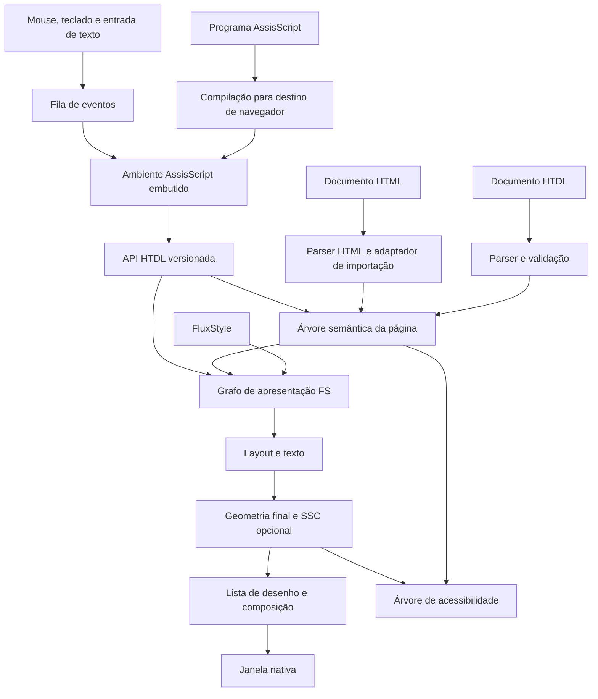

# Visão do ecossistema

Estado: proposta inicial, 24/10/2026. As premissas informadas pelo autor estão separadas das recomendações em [Decisões](06-decisoes-e-fontes.md).

## HTDL, AssisScript, FluxStyle e SSC

| Camada | Responsabilidade | Exemplo de decisão pertencente à camada |
| --- | --- | --- |
| HTDL | Estrutura, semântica, metadados e declaração das conexões com programas | Este nó é um botão; este texto é um título; este botão chama `incrementar` |
| AssisScript | Implementação do navegador e, em ambiente isolado, estado, algoritmos e eventos das páginas | Desenhar a janela do navegador; incrementar o contador de uma página |
| FluxStyle (FS) | Apresentação dinâmica por fluxo; proposta de dependências explícitas para layout, pintura e destinos físicos | Um estado atualiza largura, cor e deslocamento desejado |
| SSC (SanSCript) | Dinâmica física declarativa, como molas, inércia e mundos delimitados | Fazer um painel acomodar-se no destino produzido pelo FS |

Uma mesma página pode funcionar sem programação e usar os estilos padrão do navegador. O carregamento de estilo não deve ser condição para ler o documento ou usar seus controles.

O AssisScript continua sendo uma linguagem de programação completa, desenvolvida em seu próprio projeto. O navegador acrescenta um ambiente hospedeiro para essa linguagem, com biblioteca e limites próprios. Evoluções gerais do compilador permanecem no projeto AssisScript; o navegador consome uma versão compatível.

A visão atual exige também que o próprio navegador seja escrito em AssisScript. Isso cria duas frentes: capacidades nativas para construir o aplicativo e execução isolada para programas de página. Privacidade, customização, busca própria e importação HTML estão detalhadas na [visão atualizada](08-navegador-assisscript-privacidade-e-busca.md). O grupo escolheu FluxStyle como linguagem de apresentação; o [modelo de fluxo FS](09-fluxstyle-e-fluxo.md) é uma proposta para concretizar essa direção. O contexto das ideias de física permanece em [SSC e propostas visuais](07-propostas-visuais-e-ssc.md).

## O significado de usar somente divs

A grafia única reduz o vocabulário de tags. A variedade semântica reside no atributo obrigatório `type`.

`
Salvar
` cria um controle com nome acessível, foco, ativação por teclado e estado desabilitado. Essas responsabilidades pertencem ao motor HTDL. Uma página não precisa recriar esse comportamento em AssisScript.

O motor terá um registro fechado de tipos na versão 0.1. Tipos desconhecidos produzem erro de validação. Novos tipos poderão ser introduzidos por versões posteriores; componentes autorais serão definidos em uma proposta separada, evitando transformar qualquer erro de digitação em um componente válido.

Textos e comentários são construções lexicais, não outras tags. Não há `html`, `head`, `script` ou `style` como elementos: quando necessários, são tipos de `div`.

## Motor próprio e aplicativo de navegador

O **motor** lê HTDL, mantém a árvore da página, calcula apresentação e executa AssisScript. O **aplicativo de navegador** acrescenta janela, abas, barra de endereços, histórico, configurações, permissões e ferramentas de desenvolvimento.

Essa divisão permite testar o motor sem abrir janelas e, depois, utilizá-lo em outras aplicações. A recomendação para o destino final é renderização nativa. Uma eventual conversão para HTML serviria como ferramenta auxiliar de prévia, com diferenças explicitadas; não seria a definição da plataforma.

O diagrama mostra responsabilidades, não exige um processo ou uma biblioteca para cada caixa. Rede e armazenamento serão serviços mediados pelo navegador, quando introduzidos.

## Organização recomendada

| Projeto ou módulo futuro | O que contém |
| --- | --- |
| AssisScript, pasta existente | Sintaxe, análise de tipos, modelo de memória, compiladores e biblioteca geral |
| `htdl-spec` | Especificações e exemplos normativos |
| `htdl-parser` | Lexer, parser, árvore sintática e diagnóstico |
| `htdl-import` | Importação de HTML e adaptadores de compatibilidade explicitamente suportados |
| `htdl-document` | Tipos, árvore semântica, validação e operações sobre nós |
| `htdl-style` | FluxStyle, grafo de dependências e apresentação computada |
| `htdl-layout` / `htdl-render` | Medição, posicionamento, desenho e acerto de ponteiro sobre a página |
| `htdl-physics` | SSC e integração de dinâmica com a geometria consolidada |
| `htdl-script-host` | Runtime embutido, API para a página, eventos e quotas |
| `htdl-browser` | Interface e serviços privilegiados, com implementação final em AssisScript |
| `htdl-search-client` | Seleção de provedor e apresentação de resultados; busca própria é uma frente adicional |
| `htdl-tools` | Verificador, formatador, servidor de desenvolvimento e integração com editor |
| `htdl-conformance` | Casos positivos e negativos e verificações de comportamento compartilhadas |

Esses nomes descrevem limites de responsabilidade. Não é necessário começar com vários repositórios ou pacotes. A pasta HTDL pode abrigar os módulos iniciais; o compilador AssisScript permanece separado, com integração por artefatos e contratos versionados.

## Ciclo de uma página

1. Resolver o endereço e carregar o documento sob limites de tamanho e tempo.
2. Analisar o documento inteiro, validar sua estrutura e registrar IDs e referências.
3. Construir a árvore semântica e os estilos padrão; a página estática já pode ser desenhada.
4. Resolver os recursos declarados. No desenvolvimento local, compilar AssisScript com uma versão conhecida do compilador. Em distribuição, carregar o módulo previamente compilado.
5. Validar versão da API, imports permitidos, memória e assinaturas das funções referenciadas.
6. Criar a instância do programa e chamar `assis_assis()` uma vez. Retorno zero significa inicialização concluída; `void` também é aceito. Retorno diferente de zero suspende a interatividade e gera diagnóstico.
7. Liberar a fila de eventos para os manipuladores. Cada execução é serializada; alterações visuais são consolidadas ao terminar a tarefa.
8. Ao navegar ou fechar a aba, cancelar tarefas, invalidar identificadores e descartar toda a instância e os recursos da página.

Não se executa código durante a análise das tags. A ordem dos elementos `script` não cria dependência da posição do botão no arquivo. A versão 0.1 admite somente um programa por documento; suas bibliotecas são resolvidas pelo sistema de módulos do AssisScript.

## Isolamento e serviços

O programa da página terá sua própria memória. Referências a nós do navegador serão identificadores opacos, nunca endereços de memória do motor. Todo acesso passa por uma API que confere documento, geração do identificador, operação e tamanho dos dados.

A opção inicial recomendada é AssisScript compilado para WebAssembly e executado por um runtime embutido, como Wasmtime. WebAssembly exige imports explícitos e separa a memória do módulo da memória do hospedeiro; isso não substitui a validação da API ou resolve todos os erros internos do programa. [Modelo de segurança de WebAssembly](https://webassembly.org/docs/security/), [segurança do Wasmtime](https://docs.wasmtime.dev/security.html).

Para navegação remota, a arquitetura deve separar o processo privilegiado do navegador dos processos de conteúdo, com restrições do sistema operacional e comunicação validada. Um visualizador de desenvolvimento pode começar com um processo e instâncias isoladas, restrito a arquivos de teste locais. Aceitar conteúdo remoto arbitrário depende da etapa de isolamento de processos.

Limites por página abrangem memória, pilha, trabalho de execução, nós, texto, recursos decodificados e fila de eventos. Funções hospedeiras também precisam de limites próprios: interromper instruções WebAssembly não interrompe automaticamente uma chamada bloqueada do host. [Configuração de execução](https://docs.wasmtime.dev/api/wasmtime/struct.Config.html), [limites de recursos](https://docs.wasmtime.dev/api/wasmtime/struct.StoreLimitsBuilder.html).

## Endereços, recursos e distribuição

Na primeira versão local, o usuário abre explicitamente uma pasta de aplicação. Os caminhos relativos são resolvidos a partir do arquivo importador e confinados à raiz dessa aplicação, inclusive após resolução de links e normalização. A biblioteca padrão fixada pelo SDK é uma raiz adicional somente para leitura. Imports não consultam automaticamente `ASSIS_PATH` ou pastas arbitrárias da máquina.

Mais tarde, páginas remotas usarão HTTPS e uma política de origem definida pelo esquema, host e porta. Recursos ativos terão de respeitar a origem e a política explícita de compartilhamento; redirects serão revalidados. Um novo protocolo de transporte não é necessário para criar a linguagem.

Um build futuro deve gerar uma pasta estática contendo HTDL, programa compilado, recursos e descritor de versões e integridade. `.pillow` continua sendo o manifesto de fontes do AssisScript; não será reutilizado como manifesto de permissões do navegador. A extensão e o esquema de um eventual pacote de aplicação permanecem em aberto.

Não carregar executáveis PE/ELF como scripts de página. O navegador hospeda a execução da linguagem por um destino próprio; arquivos nativos continuam pertencendo ao uso independente do AssisScript.

## Ferramentas desejadas

O primeiro utilitário será um verificador de HTDL, com erros em português, arquivo, trecho e posição. Depois vêm formatador, realce, conclusão de `type`, navegação entre evento e função, inspetor da árvore, estilos computados, layout, acessibilidade e console AssisScript.

Comandos como `htdl check`, `htdl format`, `htdl dev` e `htdl build` são nomes sugeridos, ainda inexistentes. O ambiente de desenvolvimento poderá compilar e recarregar páginas; o navegador distribuído não precisará ter todo o compilador instalado.
