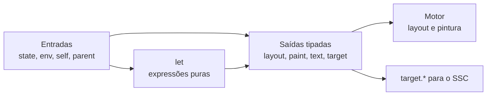

# FluxStyle (FS) 0.1 — referência do rascunho

Estado: rascunho de referência, 25/10/2026. Reúne em um só lugar o que os documentos [09](09-fluxstyle-e-fluxo.md), [04](04-estilo-e-renderizacao.md) e [07](07-propostas-visuais-e-ssc.md) já propõem e completa as lacunas com propostas marcadas. **Não existe compilador FS**: nada aqui descreve funcionalidade implementada. Código, identificadores e comentários dos exemplos de FS estão em inglês; a explicação, em português.

Este documento é o primeiro de três. O [SSC](11-ssc-referencia.md) descreve a física e o [contrato FS ↔ SSC e o papel do AssisScript](12-contrato-fs-ssc-e-assisscript.md) descreve como as duas linguagens e o programa da página se encaixam.

**Revisão técnica de 25/10:** as questões [A] foram respondidas e as propostas [N] avaliadas no [parecer A01–A14/N01–N21](13-revisao-extensoes-abertos-e-propostas.md). As correções principais estão incorporadas abaixo. Uma recomendação técnica revisada não é automaticamente uma decisão [G] do grupo.

**Detalhamento de 27/10:** [gramática](16-gramaticas-fs-e-ssc.md) e [protocolo de execução](17-execucao-transacoes-e-layout.md) completam este rascunho com tipos enumerados explícitos, domínios de propriedade, restrições de largura e fallback sobre a árvore semântica atual. Afirmações sobre capacidades do AssisScript nesta referência descrevem os snapshots anteriores; não foram reavaliadas durante o teste de 24 horas.

## Como ler as marcas

| Marca | Significado |
| --- | --- |
| **[G]** | Decisão do grupo (premissa informada pelo autor) |
| **[P]** | Proposta que já consta nos documentos 01–09 |
| **[N]** | Proposta nova deste documento; precisa de revisão do grupo |
| **[A]** | Questão levantada pelo rascunho; as respostas desta revisão estão no documento 13 |
| **[R]** | Recomendação técnica após revisão; não implica ratificação pelo grupo |

As palavras **deve**, **não deve** e **pode** têm o mesmo sentido do [HTDL 0.1](02-htdl-0.1.md): descrevem o comportamento pretendido de uma implementação futura que declare suporte à versão.

## 1. Papel do FS

**[G]** FS é a linguagem de apresentação do ecossistema. Substitui o CSS e é dinâmico por padrão. **[G]** O SSC é seu parceiro: calcula o movimento físico até os destinos que o FS define.

A pergunta que o FS responde é: *dadas estas entradas, qual apresentação cada nó deve ter?*

| O FS faz | O FS não faz |
| --- | --- |
| Ler entradas: estado da página, ambiente do navegador, estado visual do nó, espaço disponível | Executar ações, validar regras de negócio ou alterar o estado da aplicação (isso é do AssisScript) |
| Calcular valores derivados com expressões puras | Alterar a árvore HTDL, o `type` ou o significado dos elementos |
| Produzir layout, pintura, texto e destinos físicos (`layout`, `paint`, `text`, `target`) | Fazer rede, ler arquivos ou persistir dados |
| Rejeitar conflitos, ciclos e erros de unidade antes de ativar uma configuração | Ler a geometria final de um nó (nesta versão) |
| Confirmar todas as saídas de uma mudança juntas | Mover coisas no tempo (isso é do SSC) |
| | Resolver conflitos por especificidade ou ordem no arquivo (não há cascata autoral) |

## 2. Modelo em uma página

**[P]** Entradas alimentam transformações, que produzem layout, pintura e destinos físicos. O navegador mantém as dependências e atualiza só o que foi afetado.



"Fluxo" tem dois sentidos, e a linguagem usa os dois:

- **Fluxo de dados:** estado, espaço disponível e preferências se propagam por dependências explícitas.
- **Fluxo espacial:** o resultado organiza conteúdo em linhas, colunas e quebras.

Uma página em repouso não recalcula nada a cada quadro. Só uma mudança de entrada dispara avaliação.

## 3. Estrutura do arquivo

Um arquivo FS contém declarações `flow` e `bind`, em qualquer ordem. A ordem das declarações não tem significado.

```text
flow CardVisuals {
    input expanded: bool = state("card.expanded", false);
    let cardLift = choose(expanded, -8px, 0px);
    cardLift -> target.offsetY;
}

bind .card to CardVisuals;
```

- `flow Nome { ... }` declara um conjunto reutilizável de entradas, valores derivados e saídas.
- `bind seletor to Nome;` instancia o fluxo para cada nó HTDL que corresponder ao seletor.

Convenções léxicas:

- UTF-8, com BOM inicial opcional, como no HTDL. **[N]**
- Comentários `// até o fim da linha` e `/* ... */`, este último com aninhamento, como no AssisScript. **[N]**
- Identificadores `[A-Za-z_][A-Za-z0-9_]*`, sensíveis a maiúsculas. Nomes de fluxo em PascalCase e propriedades em camelCase (`offsetY`, `availableWidth`). **[N]** O documento 04 lista campos internos em snake_case (`offset_x`); eles são representação interna, não sintaxe de autoria.
- Palavras reservadas: `flow`, `input`, `let`, `bind`, `to`, `true`, `false`. **[N]**

**[R — A03] Carregamento.** Propor HTDL 0.2 com `<div type="presentation" src="./card.fxs" language="fluxstyle"></div>` e outro recurso com `language="ssc"` para física. A 0.1 não muda. `language` identifica a linguagem, independentemente de usar `.fxs` ou `.flux`; os recursos e vínculos são validados antes de ativar a configuração. O contrato detalhado está no parecer.

**[G] Extensões.** `.fxs` é a preferida e `.flux` também é válida, com a mesma linguagem e versão. Exemplos e futuros geradores usam `.fxs`. O nome de arquivo não promete que já exista compilador FS.

## 4. Tipos e literais

| Tipo | Literais | Observação |
| --- | --- | --- |
| `bool` | `true`, `false` | |
| `number` | `42`, `0.8`, `50%` | `50%` é açúcar para `0.5`. **[N]** |
| `length` | `12px`, `-8px` | Pixel lógico é a única unidade da 0.1 **[P]** |
| `time` | `280ms`, `0.3s` | Usado pelo SSC |
| `frequency` | `4Hz` | Usado pelo SSC |
| `color` | `#rgb`, `#rrggbb`, `#rrggbbaa` | sRGB |
| `colorScheme`, `contrast` | `light`, `dark`; `normal`, `high` | Tipos fechados das entradas de ambiente, explicitados no detalhamento de 27/10 |
| enumeração | `start`, `center`, `end`, `stretch`, `clip`, `scroll` | Identificador sem aspas; o tipo vem da propriedade de destino |
| layout | `block()`, `row(gap: 8px)`, `column(gap: 12px)` | Construtores aceitos por `layout.children` |
| `string` | `"card.expanded"` | Só como chave de `state` e nome de fonte; não é computável |

**Porcentagem sem referência escondida. [N]** A exigência do documento 04 (cada porcentagem declara sua referência) fica resolvida assim: `50%` é só o número `0.5`, e a referência aparece na expressão, como em `parent.availableWidth * 50%`. Não existe `width: 50%` implícito.

**Modelo numérico. [N]** Esta é a decisão de maior impacto do documento. O snapshot AssisScript inspecionado em 25/10 oferecia `int` de 64 bits sem `float`; isso motivou a proposta de **ponto fixo Q16.16 sobre `int64`** para a semântica de referência de FS/SSC. Não é uma avaliação da versão atual da linguagem. O perfil permanece experimental mesmo que novos tipos numéricos já estejam disponíveis:

- `number`, `length`, `time` e `frequency` guardam o valor multiplicado por 65536. A resolução é 1/65536 e o intervalo vai de −32768 a +32767,99998.
- O perfil experimental limita valores públicos aos inteiros codificados de 32 bits; armazená-los em `int64` não implica essa faixa por si só. Estados/intermediários da física podem exigir faixa maior, com checagem própria.
- Um literal decimal é arredondado ao mais próximo, com empate afastando de zero (`0.8` vira 52429). Aplicar o sinal antes da checagem final permite representar o limite negativo.
- Multiplicação usa `(a*b + 32768) >> 16`, com empate para +infinito; divisão arredonda ao mais próximo, com empate para +infinito após normalizar o sinal do divisor. Conferir os intermediários antes de qualquer overflow modular. A diferença entre conversão e produto é explícita, preservando os traços existentes.
- Todo resultado de operação fora do intervalo é o erro `F401`; divisão por zero é `F402`. Não existem NaN nem infinito. Assim, "valores não finitos devem gerar erro definido" (documento 09) vale por construção.
- Uma implementação pode usar outra representação interna, desde que produza resultados idênticos aos de referência para todo programa válido.
- Trajetórias podem ser idênticas entre plataformas quando valores codificados, coeficientes, arredondamentos e sequência de passos também são idênticos. Aritmética inteira isoladamente não prova essas condições.

**Parecer N03:** este é um perfil numérico experimental, não uma decisão geral já ratificada. Congelar a conformidade depende de vetores completos de operações e coeficientes e de limites adequados a layout real. Se o AssisScript ganhar `f64`, usar esse tipo não dispensa cumprir o perfil de referência escolhido.

## 5. Expressões

Expressões são **puras**: sem atribuição, sem efeitos, sem laços, sem chamadas ao AssisScript e sem rede.

Precedência, da mais forte para a mais fraca: `-` e `!` unários; `*` e `/`; `+` e `-`; `<` `<=` `>` `>=`; `==` e `!=`; `&&`; `||`. Parênteses agrupam. `&&`, `||` e `choose` avaliam só o que precisam.

### Aritmética dimensional

| Operação | Resultado |
| --- | --- |
| `number ± number`, `length ± length`, `time ± time` | mesmo tipo |
| `number * number` | `number` |
| `length * number`, `number * length` | `length` |
| `length / number` | `length` |
| `length / length`, `time / time` | `number` |
| `frequency * time`, `time * frequency` | `number` |
| Comparações entre valores da mesma dimensão | `bool` |
| `color` | só `choose`, `==` e `!=`; sem aritmética |
| Qualquer outra combinação | erro `F201` |

### Funções do núcleo

| Função | Tipos | Semântica |
| --- | --- | --- |
| `choose(c, a, b)` | `bool, T, T → T` | Avalia só o ramo escolhido. Os dois ramos são tipados e entram na análise de ciclos **[P]** |
| `min(a, b)`, `max(a, b)` | `T, T → T`, em `number`, `length`, `time`, `frequency` | |
| `clamp(v, lo, hi)` | `T, T, T → T` | `lo <= hi`, senão `F403` |
| `abs(v)` | `T → T`, apenas nos tipos numéricos/dimensionais | **[N, revisada]** Resultado fora da faixa é `F401` |

## 6. Entradas

Uma entrada é uma fonte externa **somente para leitura**, com tipo declarado:

```text
input expanded: bool = state("card.expanded", false);
input available: length = parent.availableWidth;
```

| Fonte | Tipo | Quem fornece |
| --- | --- | --- |
| `state("chave", padrão)` | `bool` ou `number` inteiro | AssisScript, pela API de estado do navegador **[P]** |
| `parent.availableWidth` | `length` | Passe de layout, a partir da restrição resolvida do pai **[P]** |
| `self.focused`, `self.hovered`, `self.pressed`, `self.disabled`, `self.checked`, `self.invalid` | `bool` | Motor, a partir do estado do nó e da interação **[N]** (estados exigidos pelo documento 04) |
| `env.reducedMotion` | `bool` | Navegador, preferência do usuário **[N]** |
| `env.colorScheme` | enumeração (`light`, `dark`) | Navegador **[N]** |
| `env.contrast` | enumeração (`normal`, `high`) | Navegador **[N]** |
| `env.textScale` | `number` | Navegador **[N]** |

Regras:

- **`state`.** A chave é um texto literal `[a-z][a-z0-9_.-]*`. O padrão é um literal do tipo declarado. Hoje a API de estado do AssisScript só grava `int` (`htdl_estado_int_definir`), então `bool` mapeia para 0 e 1 (qualquer valor diferente de zero é `true`) e `number` só representa inteiros. Valor inteiro fora do intervalo Q16.16 rejeita a transação com `F401`. Fracionários exigirão uma função própria na API. **[N]**
- **Mesma chave/escopo com tipos diferentes** em fluxos diferentes é erro `F304`. Padrões diferentes para a mesma chave/escopo são `F306`. Chave ausente usa o padrão registrado; chave presente com zero não é ausência.
- **`parent.availableWidth`** só existe onde o layout informa uma largura definida. Usá-la em outro contexto é erro `F303` na ligação. A primeira implementação deve anunciar os contextos válidos. **[P]**
- **`self.*`** só existe nos tipos HTDL que têm o estado (por exemplo, `self.checked` só em `input` de `kind="checkbox"`). Usá-lo em outro nó é `F204`.
- **`env.*`** é um catálogo pequeno e fechado. O FS não pode enumerar fontes, temas ou características de hardware. Valores podem ser quantizados para reduzir a superfície de identificação. **[P]**
- **[R — A02] Escopo do estado.** Sem terceiro argumento, a chave é compartilhada por toda a instância da página. Aceitar no rascunho `state("expanded", false, scope: node)`, com API correspondente por handle. O estado local inclui a geração do nó, não seu ID textual; remover o nó destrói esse estado. A sintaxe e a API ainda não estão implementadas.

## 7. Saídas

Uma saída liga um valor a uma propriedade tipada: `valor -> propriedade;`. A coluna "Invalida" diz o que o motor precisa refazer quando o valor muda; é isso que permite que mudar uma cor não exija novo layout **[P]**.

| Propriedade | Tipo | Padrão | Invalida | Primeira prova |
| --- | --- | --- | --- | --- |
| `layout.width` | `length` | `auto` | layout | ★ |
| `layout.height` | `length` | `auto` | layout | |
| `layout.padding` | `length` | `0px` | layout | ★ |
| `layout.children` | `block()`, `row(...)`, `column(...)` | `block()` | layout | ★ |
| `layout.align` | `start`, `center`, `end`, `stretch` | `stretch` | layout | |
| `layout.overflow` | `visible`, `clip`, `scroll` | `visible` | layout | |
| `paint.background` | `color` | por `type` | pintura | ★ |
| `paint.text` | `color` | por `type` | pintura | ★ |
| `paint.radius` | `length` | `0px` | pintura | ★ |
| `paint.opacity` | `number` de 0 a 1 | `1` | pintura | |
| `text.size` | `length` | por `type` | layout e medição | |
| `text.weight` | `number` de 100 a 900 | `400` | layout e medição | |
| `text.align` | `start`, `center`, `end` | `start` | layout | |
| `target.offsetX` | `length` | `0px` | só SSC e composição | |
| `target.offsetY` | `length` | `0px` | só SSC e composição | ★ |

★ marca as propriedades do primeiro exemplo (documento 09). As demais são candidatas **[P]**, tiradas do `ComputedStyle` do documento 04. Propriedade fora desta lista é erro `F202`, com sugestão quando a grafia for próxima. Recurso ainda sem suporte deve produzir erro claro, nunca ser ignorado em silêncio **[P]**.

Os padrões vêm do motor, por `type` HTDL **[P]**. Um nó sem produtor autoral para uma propriedade usa o padrão do motor. Isso garante que uma página sem FS continue legível e utilizável.

`type` nunca expressa aparência. Não existe `blue-button`; variantes visuais são classes **[P]**.

## 8. Ligação e as três regras centrais

**[P]** Estas três regras concretizam a proposta de fluxo e foram revisadas tecnicamente. Nome e direção do FS são decisões do grupo; sua formalização detalhada permanece um contrato de rascunho.

### Ligação

`bind` aceita `.classe` e `#id` **[P]**. Sem especificidade e sem prioridade por tipo de seletor. Um nó corresponde a `.card` se sua lista `class` contiver `card`. **[R — A07]** Seletores por `type` e compostos ficam fora da 0.1; uma extensão futura não lhes concede prioridade para resolver conflitos.

- Vincular o mesmo fluxo duas vezes ao mesmo nó é idempotente: é o mesmo produtor. **[N]**
- Um `bind` sem nenhuma correspondência não é erro; gera o aviso `F305`. **[N]**
- Quando uma classe muda em tempo de execução, os vínculos afetados são revalidados. Se a mudança produzir conflito, a atualização de apresentação é rejeitada como unidade e a configuração válida anterior permanece **[P]**.

### Regra 1: dependências explícitas

O programa FS forma um grafo: entradas, valores `let` e saídas são vértices; cada referência é uma aresta. O grafo deve ser acíclico. Um ciclo é erro `F301`, e a mensagem mostra o caminho completo. A análise de ciclos considera os dois ramos de `choose`.

A ordem dos `let` no texto não importa. O avaliador usa ordem topológica. Mudar uma entrada marca como sujo tudo o que depende dela.

### Regra 2: uma origem por propriedade

Para cada par (nó, propriedade) pode existir **no máximo um produtor** entre todos os fluxos vinculados ao nó, e no máximo uma instrução por propriedade dentro de um fluxo. Identidade de seletor, proximidade e posição no arquivo **não** resolvem conflitos.

Dois fluxos no mesmo nó são permitidos quando produzem propriedades **disjuntas**:

```text
flow Surface {
    #252936 -> paint.background;
    12px -> paint.radius;
}

flow Spacing {
    20px -> layout.padding;
}

bind .card to Surface;
bind .card to Spacing;
```

Este caso, tirado do documento 09, é **deliberadamente inválido**:

```text
flow CardAccent {
    #ff9900 -> paint.background;
}

bind .card to CardVisuals;
bind #featuredCard to CardAccent;
// If #featuredCard also has class "card", paint.background has two producers.
// This is error F302. The id does not win.
```

Formas de compor na 0.1: reunir a escolha em um `choose` no mesmo fluxo, extrair um valor compartilhado para um fluxo único ou usar produtores disjuntos. **[R — A08]** Fluxos parametrizados ficam para depois da 0.1; sua sintaxe anterior era uma sugestão, não construção aceita no núcleo.

Herança de apresentação, quando desejada, é declarada como dependência. Não existe sobrescrita por ancestralidade **[P]**.

**[R — A06] Preferências e acessibilidade.** Aplicar a política do navegador **após os valores autorais e antes de medir texto e fazer layout**. Preservar valor autoral e efetivo no inspetor. Escala de texto incide uma vez sobre a base de cada transação; não multiplicar repetidamente o resultado efetivo. Cores forçadas e movimento reduzido são políticas próprias, não disputa entre seletores. O autor que consulta `env.textScale` para adaptar layout não precisa multiplicar `text.size` novamente.

### Regra 3: atualizações consistentes

Ver a seção seguinte.

## 9. Avaliação e transação

**[P]** Uma tarefa nunca mostra metade das saídas do estado anterior e metade do novo. O protocolo:

1. Analisar e tipar os fluxos, preservando posições do fonte.
2. Resolver vínculos, produtores e dependências para os nós da página.
3. Rejeitar ciclos e conflitos antes de ativar a configuração.
4. Receber mudanças de estado e ambiente como **um lote com versão**.
5. Propagar invalidações e avaliar valores derivados em ordem topológica.
6. Executar os passes de layout necessários e preparar pintura e destinos do SSC.
7. **Confirmar** todas as saídas de uma vez e só então publicar geometria e desenho.

Detalhes:

- A transação cobre **a página inteira** em cada tarefa, não um nó isolado, para que nós relacionados não apareçam em estados diferentes. **[N]**
- Qualquer erro de avaliação (`F401`, `F402`, `F403` e o domínio proposto `F404`) cancela a transação de saídas autorais inteira. A configuração anterior continua ativa e o diagnóstico mostra o fluxo, a linha e a entrada que mudou. **[N/R]**
- A transação é de **apresentação**. Ela não reverte automaticamente estado ou mutações semânticas já confirmadas pelo AssisScript. O programa pode corrigir o estado que levou à rejeição.
- **[R, detalhamento de 27/10]** Saídas autorais anteriores são reaplicadas aos nós sobreviventes da árvore atual; removidos deixam de existir e novos usam padrões. Texto, `hidden`, `disabled`, foco e acessibilidade acompanham a semântica atual, conforme o [protocolo](17-execucao-transacoes-e-layout.md). Não congelar uma árvore antiga como efeito de um erro FS.
- Eventos recebidos durante uma avaliação entram na tarefa seguinte, sem reentrada **[P]**.
- Na primeira prova, recalcular o fluxo inteiro é aceitável, desde que o resultado seja o mesmo. "Recalcular só o necessário" é meta de implementação e medição, não garantia de custo constante **[P]**.
- Falha de carregamento do FS não impede ler o documento: a página aparece com os estilos padrão. Estilo nunca é condição para ler HTDL **[P]**.

### Limites que o FS respeita

- `hidden="true"` exclui a subárvore do desenho e da árvore acessível, e o FS não consegue desfazer isso. O FS também não produz `hidden`; quem oculta é o programa, pela API do HTDL.
- `paint.opacity` igual a 0 **não** oculta nada para tecnologia assistiva.
- O FS não altera ordem semântica, ordem de foco, nome acessível nem papel do nó.
- **[R — A06]** Na 0.1 o motor mantém seu indicador de foco e FS não o substitui. `paint.focusRing` não está definida e não é aceita nesta versão. Uma propriedade futura precisa de contrato de visibilidade e acessibilidade antes de permitir substituição.

## 10. Diagnósticos

**[N]** Famílias sugeridas, no mesmo espírito dos códigos `H1xx` a `H4xx` do HTDL: `F1xx` léxico e sintaxe, `F2xx` tipos e unidades, `F3xx` vínculos, conflitos e ciclos, `F4xx` avaliação. Mensagens em português, apontando arquivo, trecho e posição.

| Código | Situação | Mensagem sugerida |
| --- | --- | --- |
| `F101` | Literal inválido | `F101: literal de cor inválido '#12'` |
| `F102` | Construção inesperada | `F102: esperado ';' depois de 'let cardWidth = ...'` |
| `F201` | Tipos ou dimensões incompatíveis | `F201: 'color' não pode alimentar 'layout.width' (esperado 'length')` |
| `F202` | Propriedade de destino desconhecida | `F202: 'paint.backgroud' não existe; quis dizer 'paint.background'?` |
| `F203` | Ramos de `choose` com tipos diferentes | `F203: os ramos de 'choose' têm tipos diferentes ('length' e 'number')` |
| `F204` | Entrada indisponível para o tipo do nó | `F204: 'self.checked' só existe em input de tipo checkbox` |
| `F301` | Ciclo de dependência | `F301: ciclo: a -> b -> a` |
| `F302` | Duas origens para a mesma propriedade | `F302: 'paint.background' em #featuredCard tem duas origens: CardVisuals (card.fxs:12) e CardAccent (accent.fxs:3)` |
| `F303` | `parent.availableWidth` indefinida neste contexto | `F303: 'parent.availableWidth' não é definida para este layout` |
| `F304` | Mesma chave de estado com tipos diferentes | `F304: a chave 'card.expanded' é bool em CardVisuals e number em Panel` |
| `F305` | `bind` sem correspondência (aviso) | `F305: '.cardd' não corresponde a nenhum nó` |
| `F306` | Padrões diferentes para a mesma chave/escopo | `F306: 'expanded' possui padrões incompatíveis no mesmo escopo` |
| `F401` | Resultado fora do intervalo numérico | `F401: 640px * 100 excede o intervalo de 'length'` |
| `F402` | Divisão por zero | `F402: divisão por zero em 'cardWidth'` |
| `F403` | Intervalo inválido | `F403: clamp(v, 10px, 4px): o mínimo é maior que o máximo` |

## 11. Exemplos

### 11.1 O cartão (o exemplo do grupo)

Igual a [`card.fxs`](../exemplos/fluxstyle/card.fxs):

```text
flow CardVisuals {
    input expanded: bool = state("card.expanded", false);
    input available: length = parent.availableWidth;

    let cardWidth = min(available, choose(expanded, 640px, 320px));
    let cardLift = choose(expanded, -8px, 0px);

    cardWidth -> layout.width;
    20px -> layout.padding;
    column(gap: 12px) -> layout.children;
    choose(expanded, #7454d8, #252936) -> paint.background;
    #f4f1ff -> paint.text;
    12px -> paint.radius;
    cardLift -> target.offsetY;
}

bind .card to CardVisuals;
```

Quando `card.expanded` muda, invalidam-se `cardWidth`, `cardLift` e a cor de fundo. `paint.text`, `paint.radius` e o espaçamento são constantes. A largura exige layout, a cor exige pintura e o destino vertical segue para o SSC.

### 11.2 Adaptação sem consultas de mídia

Adaptar ao espaço disponível é só mais uma entrada. **[N]**

```text
flow Toolbar {
    input available: length = parent.availableWidth;

    let narrow = available < 480px;

    choose(narrow, column(gap: 8px), row(gap: 16px)) -> layout.children;
    choose(narrow, 12px, 20px) -> layout.padding;
}

bind .toolbar to Toolbar;
```

### 11.3 Estados de interação

```text
flow ActionButton {
    input focused: bool = self.focused;
    input disabled: bool = self.disabled;

    choose(disabled, #3a3d4a, choose(focused, #7454d8, #4a3fa0)) -> paint.background;
    choose(disabled, #8a8da0, #ffffff) -> paint.text;
}

bind .action to ActionButton;
```

### 11.4 Três erros que o verificador deve pegar

```text
flow Broken {
    let a = b + 1px;   // F301: cycle a -> b -> a
    let b = a - 1px;
    a -> layout.width;
    #7454d8 -> layout.height;   // F201: color cannot feed length
}

flow Other {
    #fff -> paint.text;
}

flow Another {
    #000 -> paint.text;
}

bind .box to Other;
bind .box to Another;   // F302: paint.text has two producers on .box
```

## 12. Fora do núcleo 0.1

Estas ideias existem nos documentos anteriores e continuam possíveis, mas **não** fazem parte da 0.1:

- Laços autorais, funções com efeitos, reflexão do navegador e alteração arbitrária da árvore **[P]**.
- Resolvedor geral de restrições e relações entre elementos (a ideia TRAMA do documento 07).
- Materiais reutilizáveis que expandem para um grupo de produtores (a ideia MATÉRIA).
- Cenários locais escolhidos pelo usuário (leitura, painel, bancada).
- Interpolação (`mix`), tokens compartilhados, módulos e importação entre arquivos.
- Leitura da geometria final de um nó. Exige um contrato temporal próprio **[P]**.
- O dialeto cultural BG++ (`background-color` como introdutor de declaração). É opção do projeto, depois de validar um núcleo legível.

## 13. Respostas da revisão às questões do FS

| Questão | Recomendação | Decidir até |
| --- | --- | --- |
| Modelo numérico | Perfil fixo experimental, com arredondamentos explícitos; sem garantia global extrapolada (A01/N03/N15) | Antes de congelar M6 |
| Estado por instância | `scope: node` e API por handle/generation, com destruição junto do nó (A02) | M6 |
| Carregamento | `type="presentation"`, `src`, `language`, em HTDL 0.2 (A03) | M6 |
| Extensões FS | `.fxs` preferida e `.flux` válida, decisão do autor (A04) | Resolvida |
| Preferências/acessibilidade | Depois dos valores autorais, antes de medição/layout; escala aplicada uma vez (A06) | M6 |
| Seletores por tipo/compostos | Adiados; sem especificidade futura para resolver conflitos (A07) | Depois da 0.1 |
| `em` | Adiado até contrato de fonte e medição (A12) | Depois do núcleo |
| Composição parametrizada | Adiada; usar escolha e produtores disjuntos na 0.1 (A08) | Depois da 0.1 |
| Indicador de foco | Manter o do motor; substituição fora da 0.1 (A06) | M6 |
| Modo de layout padrão | Manter `block()` (A12) | M6 |
| Custo do estado local | Tabela esparsa, quotas e medição; sem estimativa inventada (A14) | M6 |

Os IDs remetem ao [parecer](13-revisao-extensoes-abertos-e-propostas.md). Resposta técnica não equivale a implementação ou ratificação de todas as propostas.

Origem das propostas: documentos [09](09-fluxstyle-e-fluxo.md), [04](04-estilo-e-renderizacao.md) e [07](07-propostas-visuais-e-ssc.md), exemplo [`card.fxs`](../exemplos/fluxstyle/card.fxs) e as decisões do grupo registradas em [06](06-decisoes-e-fontes.md).
