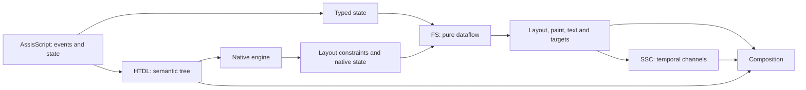

# Fundamentos, paradigmas e perfis do ecossistema

Estado: **proposta de planejamento de 27/10/2026**. Complementa a revisão do documento [13](13-revisao-extensoes-abertos-e-propostas.md). Não registra ratificação do grupo nem implementação. A documentação e os resultados anteriores do AssisScript são retratos históricos: sua capacidade atual não foi reinspecionada nesta rodada, durante o teste de 24 horas informado pelo autor.

## 1. Quatro linguagens, quatro responsabilidades

| Linguagem | Paradigma proposto | Pergunta que responde | Efeito permitido |
| --- | --- | --- | --- |
| HTDL | Árvore declarativa e semântica | O que existe e o que cada elemento significa? | Declarar conteúdo, controles, recursos e referências a eventos |
| AssisScript da página | Programação orientada a eventos, na linguagem geral existente | O que a aplicação faz quando algo acontece? | Alterar estado e conteúdo pelas capacidades oferecidas pelo navegador |
| FluxStyle | Fluxo reativo de dados tipados, sem efeitos | Qual apresentação resulta destas entradas? | Produzir propriedades de layout, texto, pintura e destinos |
| SSC | Sistema temporal declarativo | Como a apresentação chega ao destino? | Evoluir canais físicos de apresentação |

Esses paradigmas descrevem o **uso no navegador**. Não redefinem o AssisScript geral como uma linguagem exclusivamente orientada a eventos. O navegador nativo continua sendo um programa AssisScript com capacidades de plataforma próprias.

Um botão é um botão por `type="button"`, inclusive sem FS, SSC ou script. Uma cor não muda seu papel; um deslocamento não muda sua posição na ordem de leitura. Ocultar, desabilitar, editar texto e alterar valores são operações semânticas do documento, distintas da pintura.



Não há leitura da geometria composta de volta para o FS no núcleo. A dependência `parent.availableWidth` vem de uma restrição descendente de layout; não é uma medição da posição final. O [protocolo de execução](17-execucao-transacoes-e-layout.md) explica essa diferença.

## 2. O significado concreto de fluxo

Uma declaração FS descreve uma relação permanente. `expanded` mudar torna sujos seus dependentes; isso não equivale a executar novamente o programa AssisScript. `choose` seleciona valores de um mesmo tipo, e não regras concorrentes com prioridade.

```fxs
flow PanelVisuals {
    input expanded: bool = state("expanded", false, scope: node);
    let lift = choose(expanded, -8px, 0px);
    choose(expanded, #7454d8, #252936) -> paint.background;
    lift -> target.offsetY;
}

bind .panel to PanelVisuals;
```

O mesmo fluxo pode ser instanciado em dois nós. `scope: node` dá uma célula distinta a cada instância. Sem esse argumento, ambos leem uma célula da página. Um fluxo adicional pode produzir `layout.padding` nos mesmos nós, mas não uma segunda `paint.background`.

O SSC acrescenta memória temporal: posição, velocidade e destino. O FS não guarda essa trajetória nem espera por ela. Um aplicativo não pode depender de uma mola terminar para salvar dados, validar um formulário ou liberar uma ação.

## 3. Sem cascata, com políticas explícitas

O motor monta a apresentação por três operações diferentes:

1. Obtém o valor padrão de cada propriedade para o tipo semântico.
2. Substitui propriedades que tenham exatamente um produtor autoral FS válido.
3. Aplica as políticas do usuário, incluindo escala de texto, contraste e indicador nativo de foco.

A política do usuário pertence ao navegador e não disputa especificidade com seletores. No núcleo, temas são preferências locais do navegador e entradas fechadas como `env.colorScheme`. Um arquivo de tema arbitrário injetado como segundo autor produziria conflitos; plugins de aparência precisam de contrato próprio antes de serem aceitos.

**Proposta adicional:** na primeira versão não existe herança autoral implícita de FS. Uma saída só afeta o nó vinculado. Cores/tamanho de fragmentos `type="text"` sem produtor seguem o estilo textual do bloco textual que os contém, como regra de renderização desse tipo; isso não faz um `section` transmitir suas saídas a todos os descendentes. Para estilizar vários parágrafos, vincular um fluxo à classe desses parágrafos. Evitar uma herança genérica agora torna os produtores observáveis e elimina uma segunda resolução escondida.

## 4. Perfis que uma implementação poderá declarar

Os nomes abaixo são rótulos de planejamento, sem introduzir atributos novos no HTDL.

| Perfil | Conteúdo prometido | O que não fica implícito |
| --- | --- | --- |
| `document-local-0.1` | Todo o catálogo HTDL 0.1, recursos locais, controles e acessibilidade | Rede, física e execução de programas |
| `presentation-0.2-draft` | HTDL 0.2 proposto, FS 0.1 e contrato visual revisado | SSC, compilador AssisScript ou conformidade numérica final |
| `motion-0.1-experimental` | Canais SSC e um perfil numérico identificado | Colisões, forças gerais, tolerância universal ou tempo real garantido |
| `page-script-v1-draft` | ABI hospedeira, eventos, quotas e isolamento demonstrados | Autoridade nativa do navegador |
| `remote-navigation-draft` | Carregamento remoto e política de origens demonstrados | Compatibilidade geral com HTML/CSS/JavaScript |

Um protótipo que só apresenta parágrafos não declara `document-local-0.1` completo. Ele publica o subconjunto real. “Aceitar a extensão” também não significa implementar a linguagem.

## 5. Identidade, versões e compatibilidade

`.fxs` é a extensão preferida de FluxStyle e `.flux` é equivalente por decisão do autor. `.sscr` continua sendo recomendação para SanSCript. O nome-base comum é conveniência de organização e não cria ligação automática entre arquivos.

Cada entrega registra separadamente: gramática HTDL; versão FS; versão SSC; contrato FS/SSC; perfil numérico; API hospedeira; compilador e perfil de execução AssisScript; formato do cache interno. Nenhuma dessas versões é inferida de um hash de outra.

Enquanto esses contratos forem rascunhos, registrar também a revisão por data: `0.1-draft/2026-10-27` identifica este detalhamento. Não tratá-lo como uma release estável compatível com qualquer rascunho anterior chamado 0.1. Após congelamento público, mudanças incompatíveis exigem nova versão, conforme C12.

Na primeira proposta, HTDL `version="0.2"` seleciona o par FS 0.1/SSC 0.1 e o contrato visual de rascunho. O perfil numérico precisa constar do relatório da implementação. Versões futuras que admitam combinações diferentes precisarão de negociação explícita; não acrescentar `@version` aos fontes sem especificar sua gramática.

Uma extensão de catálogo não é silenciosa: um recurso desconhecido é diagnosticado. Um código FS inválido não é reinterpretado como CSS. Um `.flux` não é executado como outra linguagem Flux por semelhança do nome.

## 6. Organização recomendada da futura implementação

```text
engine/
    source/          # UTF-8, positions, diagnostics and bounded readers
    htdl/            # Parser, semantic tree and type catalog
    fluxstyle/       # Parser, types, graph and evaluator
    sanscript/       # Parser, channels, coefficients and stepping
    document/        # Handles, state, events and lifecycle
    layout/          # Constraints, text measurement and boxes
    composition/     # Paint, hit testing and accessibility snapshots
    page_runtime/    # Restricted AssisScript environment and host API
browser/
    platform/        # Window, input, graphics and native accessibility
    services/        # Resource broker, origins, storage and permissions
    shell/           # Tabs, navigation, settings and recovery
sdk/
    browser/         # Versioned page API supplied to the compiler
    tooling/         # Diagnostics, formatting and inspection protocols
```

É uma divisão de responsabilidades, não pastas já implementadas nem exigência de um sistema de módulos novo no AssisScript. Compartilhar posições e diagnósticos entre DSLs não significa compartilhar a gramática de HTDL e FS. O leitor de HTML importado é outro frontend; sua saída entra pela validação semântica comum.

## 7. Caminho para estabilizar a base

O próximo congelamento precisa produzir: gramáticas sem ambiguidades conhecidas; catálogo de propriedades e domínios; regras de eventos e falhas; exemplos positivos e negativos; cenários com resultados esperados; relatório dos pontos ainda experimentais. Os documentos [15](15-htdl-0.2-e-carregamento.md) a [19](19-conformidade-e-cenarios.md) começam essa base.

Questões que permanecem abertas exigem evidência: perfil numérico para documentos extensos, geração canônica de coeficientes, escolhas de runtime/serviços nativos, política de tema extensível, APIs de componentes e cobertura do importador. Não é necessário inventar sintaxe para essas frentes antes de definir seus contratos.
