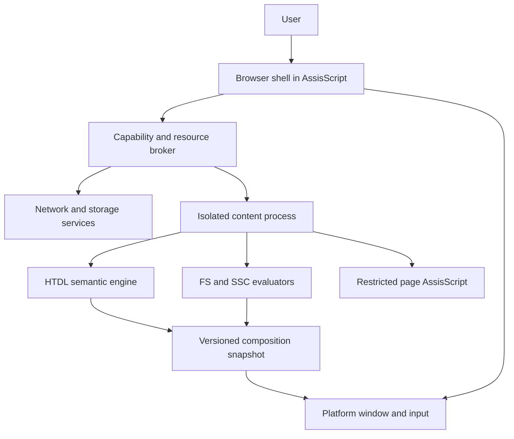

# Navegador nativo: componentes, capacidades e privacidade

Estado: **planejamento de 27/10/2026**. A meta confirmada continua sendo construir o navegador em AssisScript. Este documento define o que os componentes precisam demonstrar, sem avaliar a versão em desenvolvimento durante seu teste de 24 horas e sem declarar antigos problemas do compilador como bloqueios atuais.

## 1. Limites entre os componentes

O processo de conteúdo não recebe o diretório de perfil, cookies de outras origens, acesso irrestrito à rede nem handles nativos de janela. O broker recebe pedidos limitados e aplica política antes de acessar serviços. O renderizador valida entradas vindas da página; o shell valida mensagens vindas do conteúdo.

A interface do navegador e uma página podem usar as mesmas linguagens sem ter a mesma autoridade. Um `.htdl` baixado não se torna interface privilegiada por declarar `type="document"` ou copiar classes do shell. O contexto de execução é atribuído pelo carregador confiável.

Uma falha no processo de conteúdo deve permitir fechar/recarregar a aba. Isso exige isolamento real de processos, quotas e protocolo de mensagens; um interpretador declarativo sozinho não fornece essa garantia. Para o primeiro visualizador local de desenvolvimento, um processo único pode ser um protótipo identificado, sem anunciar isolamento de conteúdo remoto.

## 2. Contratos de serviço

| Serviço | Pedido permitido do conteúdo | Validação no limite | Resposta |
| --- | --- | --- | --- |
| Recursos da aplicação | Recurso identificado pela URL e finalidade | Instância, origem/raiz, redirecionamentos, bytes e contagem | Bytes ou erro, nunca um caminho privilegiado livre |
| Navegação | Destino de link/ação autorizada | Esquema, contexto atual, política e possível confirmação de saída | Nova navegação com epoch próprio |
| Armazenamento futuro | Operação em namespace da origem | Partição, quota e vida da instância | Resultado ou erro sem caminho nativo |
| Seletor de arquivo futuro | Solicitação originada de ação do usuário | Concessão específica de recurso | Token revogável, não acesso à pasta inteira |
| Desenho | Snapshot/recursos de composição limitados | Formato, tamanhos e gerações | Publicação ou descarte |
| Diagnósticos | Código, mensagem e spans | Tamanho, taxa e origem | Console local do navegador |

Os serviços futuros não entram automaticamente na API `htdl_v1`. Cada um precisa de versão e conjunto de cenários. A primeira fatia pode funcionar com documento, texto, estado e eventos locais.

Toda mensagem assíncrona carrega `documentInstance`, `requestId` e versão de protocolo. O broker valida tamanhos antes de alocar, reconhece pedidos repetidos quando aplicável e descarta respostas de instâncias encerradas. A página não escolhe seu próprio identificador de origem.

## 3. Origem e armazenamento

Para HTTPS, a proposta usa origem identificada por esquema, host e porta normalizados. Não implementar normalização de URL por substituição de strings. Redirecionamento, host internacionalizado e credenciais em URL exigem tratamento próprio antes de M7.

Uma aplicação local recebe origem opaca por concessão de abertura e raiz autorizada. Todas as pastas do computador não compartilham uma origem `file`. Abrir outra aplicação local não herda seu estado. Persistir a identidade de uma aplicação após reinício será uma escolha explícita de instalação, fora do leitor local inicial.

Estado de página do primeiro SDK é volátil. Persistência futura particiona ao menos por perfil do navegador e origem; conteúdo de terceiros não compartilha automaticamente a partição da primeira parte. “Limpar dados do site” precisa cancelar pedidos, revogar concessões e remover os dados daquela partição, incluindo caches que possam preservar conteúdo privado.

Cache de código/análise pode compartilhar artefatos imutáveis apenas quando isso não expõe informação entre partições. Estado, valores de formulários, handles e posições SSC nunca pertencem a um cache compartilhado de AST.

## 4. Privacidade verificável

| Observador | Informação que pode receber | Regra proposta | Evidência futura |
| --- | --- | --- | --- |
| Página | Conteúdo/interação próprios e catálogo pequeno de ambiente | Sem enumeração de fontes/hardware, sem geometria/tempo físico fino | Inventário de APIs e testes de exposição |
| Servidor de origem | Pedidos enviados ao próprio serviço | Sem prefetch remoto implícito no núcleo | Registro local de pedidos por finalidade |
| Provedor de busca | Consulta submetida pelo usuário | Sem enviar digitação nem trocar provedor silenciosamente | Comparar ações com tráfego observado |
| Operador de atualização | Pedido de atualização do navegador | Serviço separado e política publicada | Inspeção de pedidos e retenção |
| Extensão/tema futuro | Somente concessões próprias | Sem autoridade por copiar sintaxe da interface | Manifesto e testes de revogação |

`env.colorScheme`, `env.contrast`, `env.textScale` e `env.reducedMotion` já revelam preferências. Uma página pode refletir essas entradas em sua própria lógica de apresentação. Não chamá-las de “sem fingerprinting”; limitar o catálogo e quantizar valores reduz informação, mas não prova anonimato. A [orientação do W3C sobre fingerprinting](https://www.w3.org/TR/fingerprinting-guidance/) fundamenta essa revisão de superfície.

O inspetor pode mostrar dependências, caixas e canais por ser ferramenta do usuário. O programa da página não ganha essas leituras porque o inspetor existe. Logs ficam locais por padrão e omitem conteúdo de campos/consultas, salvo escolha explícita para depuração.

## 5. Customização que não recria uma cascata

Na primeira proposta, o usuário escolhe paleta, escala, contraste, movimento e configurações do navegador. Essas escolhas entram por políticas do motor e catálogo fechado de ambiente, como descrito nos [fundamentos](14-fundamentos-e-perfis.md).

Uma futura linguagem de temas pode produzir tokens do shell ou substituir uma configuração inteira de autoria. Antes de permitir injeção de regras em páginas, definir escopo, conflitos, capacidade de ocultar controles e acesso a dados. “Tema” não deve ser sinônimo automático de executar AssisScript privilegiado.

Configurações exportadas devem conter preferências e referências verificáveis, sem embutir segredos de sessão. Uma configuração inválida precisa conservar a última configuração utilizável e oferecer restauração pela interface do navegador.

## 6. Importação HTML sem contaminar a autoria nativa

O importador tem modo e cobertura próprios. A proposta inicial é **leitura estática**: árvore HTML analisada pelas regras de sua linguagem, mapeada para a árvore semântica HTDL validada. Elementos sem representação precisam de diagnóstico de perda e alternativa de conteúdo; não fingir que tabelas/mídia já cabem no catálogo 0.1.

CSS importado, quando suportado, resolve sua própria cascata em um adaptador e produz estilos computados. Esses valores não são reescritos como vários flows autorais concorrentes. No primeiro perfil de importação, a página importada não mistura esse provedor com FS autoral; preferências do usuário continuam sendo políticas do motor. Uma ponte futura precisa definir explicitamente propriedade e atualização.

Scripts JavaScript permanecem fora da primeira cobertura. Não executar um script importado como AssisScript por renomear sua extensão. Preservar origem e política de recursos, e não enviar documentos privados a um tradutor remoto automaticamente.

## 7. Capacidades exigidas do host AssisScript

Esta tabela é um contrato de aceitação futura; **não** é uma lista de recursos supostamente ausentes na versão atual.

| Capacidade | Demonstração suficiente para a primeira integração | Se houver ponte temporária |
| --- | --- | --- |
| Janela e entrada | Abrir, redimensionar, fechar e receber teclado/ponteiro | Identificar biblioteca e responsabilidade de ciclo de vida |
| Texto e acessibilidade | Acentos, seleção/IME e exportação de foco/valor | Validar cópia, encoding e thread exigida pela plataforma |
| Dados e erros | Árvore, grafo e tabelas com falhas recuperáveis | Não depender de representação interna não versionada |
| Números | Operações verificadas e perfil numérico identificado | Preservar resultados do perfil, mesmo usando outro tipo interno |
| Execução de páginas | Interromper loop, limitar memória, validar imports e impedir acesso nativo livre | Binding versionado ao runtime escolhido |
| Serviços | Resolver recursos confinados e cancelar pedidos ao fechar | Tokens opacos, tamanhos e erros explícitos |
| Isolamento de conteúdo | Encerrar conteúdo travado sem encerrar o shell | Processo e restrições de sistema operacional identificados |

WebAssembly continua candidato a formato de página; sua [especificação descreve um formato independente de linguagem e integrável em diferentes ambientes](https://webassembly.github.io/spec/core/intro/introduction.html). Escolher esse formato não implementa automaticamente APIs HTDL, quotas de funções hospedeiras ou isolamento de serviços.

O projeto AssisScript poderá atender os contratos por suas próprias bibliotecas/runtime. A revisão de capacidade deve acontecer depois do teste de 24 horas, em coordenação com seu desenvolvimento; não é dependência para continuar este planejamento.
